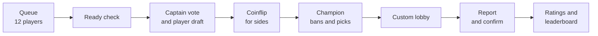

<div align="center">

<h1>
  <picture>
    <source media="(prefers-color-scheme: dark)" srcset="docs/assets/brand/dayshift-lockup-ink.svg">
    
  </picture>
</h1>

**League night, every night.**

Deadlock 6v6 inhouse PUGs on Discord, from queue to results.

[](https://discord.gg/z29nqmXUuF)
[](https://github.com/VARSITYLUNCHBUG/DayShift/actions/workflows/ci.yml)
[](https://scorecard.dev/viewer/?uri=github.com/VARSITYLUNCHBUG/DayShift)
[](LICENSE)
[](https://github.com/VARSITYLUNCHBUG/DayShift/commits/main)
[](https://github.com/VARSITYLUNCHBUG/DayShift/issues)

[](pyproject.toml)
[](https://github.com/Rapptz/discord.py)
[](https://www.djangoproject.com/)
[](https://www.postgresql.org/)
[](https://github.com/VARSITYLUNCHBUG/DayShift/pkgs/container/dayshift)

[Features](#features) |
[Web UI](#web-ui) |
[Quick start](#quick-start) |
[Documentation](#documentation) |
[Player guide](https://github.com/VARSITYLUNCHBUG/DayShift/wiki) |
[Feedback](#feedback-and-support) |
[Contributing](CONTRIBUTING.md)

</div>

---

DayShift is a self-hosted Discord bot that runs a community's Deadlock inhouses end to end.
Players join a queue with one button. The bot runs the ready check, the captain vote, the player
draft and the champion pick/ban, gets a custom lobby made, takes the result with a scoreboard
screenshot, and updates ratings and the leaderboard. Staff get a Django admin for configuration and
a private channel for disputes.

It grew out of the Bebot draft bot that the ZA Deadlock community played its PUGs on, and keeps its
look and its tools.



## Features

### For players

- **One-button queue.** First in, first out, with a ready check, DM invites and the Waiting Room
  as the lobby's voice channel.
- **Captains and a live draft.** Players vote for captains, who draft teams on the board and can
  offer player swaps before the game.
- **Champion pick/ban** on a button grid, with turn timers, a random pick and Bebot's draft board.
- **Lobbies made for you** through [deadlock-api](https://deadlock-api.com), with a manual
  fallback.
- **Subs mid-match**, offered to whoever in the queue has waited longest.
- **OpenSkill ratings** with placement, tiers, MVP and key-player awards, and a live leaderboard.

### For staff

- **Strikes and cooldowns** for dodges, leavers and missed ready checks, worked off by clean play.
- **A staff channel** with a card for every dispute, early leave and result that doesn't add up.
- **Permission areas** granted per role: match control, disputes, ratings, moderation and more.
- **A Django admin** for runtime settings, draft modes, champions, seasons and a NeatQueue import.
- **Bebot's tools**: scrim drafts, the priority list, named pings and an error channel.

### For hosts

- **One image, run with Docker Compose**, or installed on a server with Ansible: automatic HTTPS,
  nightly backups and health alerts to a Discord webhook.
- **Optional checks**: score OCR reads the scoreboard screenshot, and results are checked against
  Deadlock's match history.
- **A Discord simulator** and control panel, so the whole stack runs and tests without a real
  Discord server.

## Web UI

Players can also play on the web, signed in with Discord: the same queue, drafts, lobby and
results as the Discord buttons, live, plus hero wishes, team chat, postgame screens and a private
profile. The web service serves it from the same image. [The player web UI](docs/web-ui.md)
covers sign-in, running it locally and deploying it.

## Quick start

You need Docker with the compose plugin, and a bot from the
[Discord Developer Portal](https://discord.com/developers/applications) invited to your server.

```bash
cp .env.example .env    # then fill in the token, guild ID, secret key and database password
docker compose pull && docker compose up -d
docker compose exec web python manage.py createsuperuser
```

Then run `/setup pug_role:@PUGS` in your Discord server. The admin is on
http://127.0.0.1:8000/admin/.

The [quick start guide](docs/quickstart.md) has every step, including the invite link and how to
generate the secrets. To put the bot on the internet, use the [deploy guide](deploy/README.md).

## Documentation

| Audience | Start here |
|---|---|
| **Players** | The [player guide](https://github.com/VARSITYLUNCHBUG/DayShift/wiki): playing a match, subs, strikes, ratings and commands |
| **Server staff** | [How a match runs](docs/match-flow.md), [the admin and staff](docs/admin.md), [ratings](docs/ratings.md) and [commands](docs/commands.md) |
| **Hosts** | The [deploy guide](deploy/README.md): installing, upgrades, backups, restores, secrets and health alerts |
| **Contributors** | The [developer guide](docs/dev/README.md) and [architecture](docs/architecture.md) |

The [documentation index](docs/README.md) lists every page.

## Feedback and support

- **Community**: play in the inhouses and talk to players and staff on the
  [Deadlock South Africa Discord](https://discord.gg/z29nqmXUuF).
- **Bugs and ideas** go in [issues](https://github.com/VARSITYLUNCHBUG/DayShift/issues). The
  wiki's [Giving Feedback](https://github.com/VARSITYLUNCHBUG/DayShift/wiki#giving-feedback)
  page says what to include.
- **Security problems** are reported privately: follow [SECURITY.md](SECURITY.md).

## Contributing

Fixes and features are welcome. Read [CONTRIBUTING.md](CONTRIBUTING.md), and for anything big, open
an issue first so we can agree on the approach.

## Acknowledgments

- **\_bacon\_**, for the base build. This project started from their Bebot draft bot. Without their
  work, PUGs would be in rigor mortis and none of our current community would be possible.
- **datsir**, for porting Bebot's standalone draft, priority list, pings and error channel, which
  these versions are built from.
- **The ZA Deadlock community**, for playing in the inhouses, giving feedback and helping shape how
  the bot works.

## License

[Apache License 2.0](LICENSE). See also [NOTICE](NOTICE).

Deadlock is a trademark of Valve Corporation. This project is not affiliated with or endorsed by
Valve.
