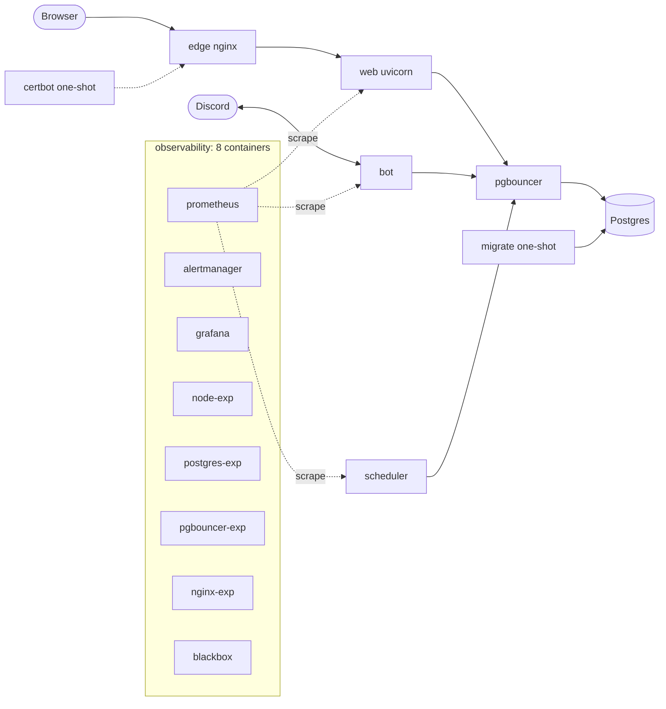
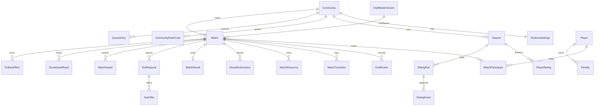

# Phase 1: Discovery (origin/main @ edfbbb7)

## What the system is

A Discord bot that runs a 6v6 Deadlock inhouse: queue, ready check, captain vote and check-in,
player draft, swaps, champion pick/ban, an automatic lobby through deadlock-api, screenshot
reporting with optional score OCR, OpenSkill ratings with awards, a NeatQueue interim, a
leaderboard, scrims, pings and a staff alert channel. The Django admin is the operator's console.

**Scale:** a hobby install. At most 50 people at once, with long idle stretches. `docs/ops/capacity.md`
measured a full match driven flat out at 3 Postgres server connections.

**Stack:** Python 3.13, Django 5.2, discord.py 2.7, Postgres 17, uvicorn (ASGI through
Channels), pydantic, openskill, httpx, prometheus-client. Optional OCR: onnxruntime, numpy, pillow.

## Size by area (lines, excluding binaries and lockfiles)

| Area | Lines | What it is |
|---|---:|---|
| `league/` | 15,441 | Models (19 files, ~38 models), 34 service modules, pure domain, admin, the dashboard |
| `bot/` | 6,760 | Handlers, slash commands, renderers, outbox effect worker, metrics |
| `tests/` | 16,267 | ~780 test functions, about 850 items once parametrized; 9 Playwright e2e tests |
| `devtools/` | 4,118 | Dev-only Django app: `/_control/` API, autopilot, seed, scenarios |
| `services/discord-sim` | 5,516 (+1,400 tests) | A fake Discord (REST, gateway) and a deadlock-api stand-in |
| `services/control-panel` | 4,944 | A React 19 / HeroUI panel over the two dev APIs |
| `deploy/` | 5,403 | Ansible: 6 roles (~192 tasks, ~480 lines of argument specs), 5 playbooks, Molecule (1,634) |
| `infra/` | 1,400 (+4,500 dashboard JSON) | nginx edge, pgbouncer, Prometheus/Alertmanager/Grafana/blackbox |
| `docs/` | 1,751 | Architecture, dev guide, 8 ops runbooks |
| `config/` | 702 | Settings, ASGI, CSP middleware, health, DB router, DB role bootstrap |

## Containers

**Production:** 14 long-running containers (6 app and infrastructure, 8 observability), 2
one-shots (migrate, certbot) and 4 host systemd units (boot, backup timer, renew timer, notify@).

**Dev and test** add discord-sim, control-panel, chrome (a Playwright server), e2e and tests.

## Data model (core)

## Key flow: a click

1. Discord sends `INTERACTION_CREATE` with `custom_id dl:v1:<action>:<match>:<step>`.
2. A bot handler validates it and calls one `league/services` function. That function takes a row
   lock with `common.lock_match`, checks the version or step, writes the state change and its
   `outbox_effects` rows, and commits.
3. The handler answers within 3 s and wakes the effect worker, which runs effects per lane with
   retries.
4. Timers are rows. The scheduler polls `deadlines`, which applies a timeout through the same path
   as a click.

## Build, CI and deploy

- **Image:** one Dockerfile with `build`, `base`, `dev` and `runtime` stages. A separate
  `scripts/docker/tests.Dockerfile` reinstalls uv and every dependency from scratch, then copies the
  whole repo, so any file change invalidates its last layer.
- **Local control:** `scripts/{fixture_to_test,test,clean_containers}.{sh,bat}`, about 1,100 lines
  of shell and batch. There is no Makefile and no Multipass path.
- **CI** (`ci.yml` + `e2e.yml` + `deploy-lint.yml` + `publish.yml` + `scorecard.yml`) has 12 jobs
  on every PR:
  - python-lint, infra-lint (pre-commit, yamllint, shellcheck, hadolint, actionlint, promtool,
    amtool)
  - unit
  - sim, panel
  - compose
  - app-image (with SBOM, provenance and Trivy), images ×4
  - changes → e2e (the whole stack), CI OK, publish (skopeo)
  - plus Ansible lint and Molecule on deploy paths
- **Deploy:** Ansible on the controller copies the compose files and `infra/{nginx,pgbouncer,observability}`
  to `/opt/draftbot`, templates `.env`, pulls the GHCR image, runs the migrate job, starts
  services one at a time, gets a certificate, starts the edge and observability, and installs
  timers.

## Measured runtimes

| Run | Where | Time |
|---|---|---|
| Molecule | GitHub runner | 19 m 49 s – 21 m 37 s |
| Molecule | the user's PC | about 46.5 min |
| e2e suite | the user's PC | 4.3 min of tests, 6–7 min including stack build and start |
| Unit suite (`test.sh --local`) | this PC | see phase 2 |

## Smells (not yet diagnosed)

1. Models are anemic: only `__str__`. There are no Managers, QuerySets or state methods. The
   Match state machine is in `services/common.py` (`transition`, `bump`, `lock_match`,
   `mode_of`, `active_participants`), with 15–46 call sites each.
2. The bot layer queries the ORM directly. `bot/commands/staff.py:570` holds a write transaction.
   The same participant filter is re-implemented in `bot/commands/staff.py:171` and
   `bot/effects/handlers.py:96,102,593`.
3. Admin actions orchestrate transactions themselves (`league/admin/__init__.py:410-438`).
4. Dead "player web UI" scaffolding on main: `WEB_GUILD_ID`, `PUBLIC_URL`, `DISCORD_CLIENT_*`,
   `WEB_DEV_LOGIN`, the `direct` DB alias with `config/db_router.py`, the Channels
   `ProtocolTypeRouter` with HTTP only, and `frontend/` in `.dockerignore` and the CI path filter.
5. Three DB connection modes (pgbouncer, psycopg pool, plain) and three Postgres logins with
   bootstrap code (`config/app_role.py`, `league/observability/monitoring_role.py`).
6. About 150 transactional tests. Each one flushes and re-runs post_migrate: contenttypes,
   trigger DDL on 10 tables, and `publish_presets` (about 0.4 s).
7. No factories: every test builds state through the full service flow (12 joins, ready, vote,
   18 draft steps and so on).
8. About 40 tests start a fresh Python process to re-import settings. `docker info` runs at
   collection on every xdist worker.
9. Infrastructure is tested in the unit suite: `test_platform_compose`, `test_platform_scripts`
   and `test_devtools_panel_contract` (a regex over TypeScript).
10. Molecule boots privileged docker-in-docker containers for two distros. It has a fake Django
    package and a 1,113-line `verify.yml`.
11. The observability stack is bigger than the app's production footprint: 8 containers, 22
    alerts, 5 dashboards and a 315-line runbook.
12. Only 6 of about 33 concrete models have a fixture row in `fixtures/dev`. Nothing requires one.
13. Windows has its own `.bat` copy of every script (575 lines) instead of one Linux path.
