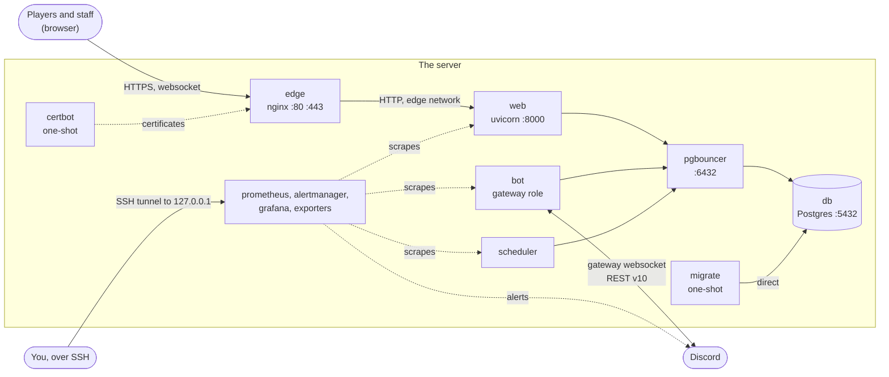
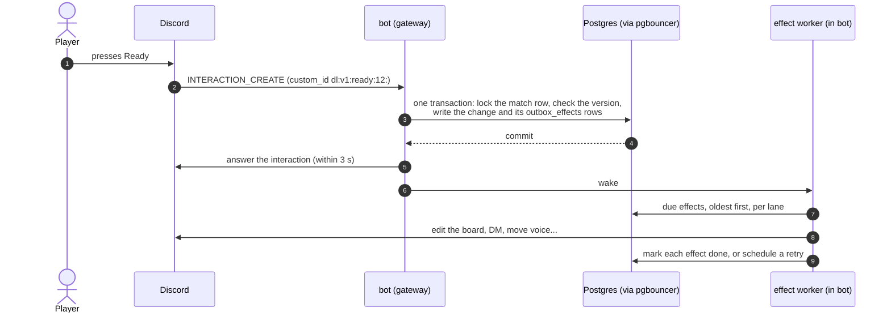
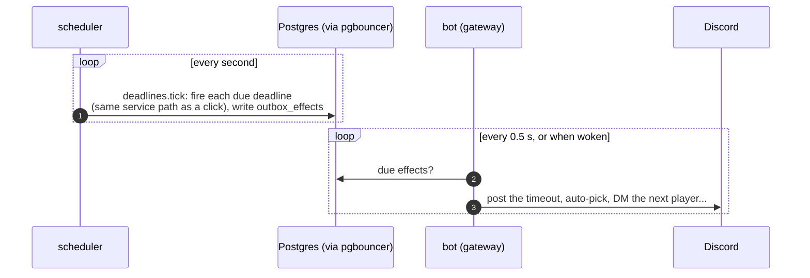

# Architecture

The bot is one Python codebase and one app image (the root `Dockerfile`), run as a few services
that each start one command from that image. Around them sit stock infrastructure images:
nginx at the edge, pgbouncer in front of Postgres, and, when you turn it on, Prometheus and
Grafana. Every environment, from your laptop to a client's server, runs the same
`compose.yaml` with one override file on top.

## Services

| Service | Image | What it does |
|---|---|---|
| `edge` | `nginxinc/nginx-unprivileged` | The only way in. TLS in production, HTTP to HTTPS, the websocket upgrade on `/ws/`, 21 MB uploads, security headers, gzip, the static files (from the `static` volume, with long cache headers for hashed names), rate limits (the admin login, `/auth/`, the admin, `/readyz`, and every client overall), optional admin access rules ([infra/nginx/admin-access](../infra/nginx/admin-access/README.md)), one JSON log line per request. Never forwards `/metrics` or `/nginx_status` (`infra/nginx`) |
| `web` | app | `uvicorn config.asgi`, one worker: the admin, the calibration dashboard and, with the web UI, the players' pages and websocket. `/healthz` says it is serving, `/readyz` that Postgres answers through pgbouncer, `/metrics` is for Prometheus |
| `bot` | app | `manage.py runbot --role gateway`: the Discord gateway connection, clicks and slash commands, and the effect worker that makes every Discord change |
| `scheduler` | app | `manage.py runbot --role scheduler`: fires due timers every second and prunes old effects daily. Database only, no Discord connection |
| `migrate` | app | One-shot: copies the image's static files to the `static` volume, runs `migrate` and `load_presets`, and creates or updates the `draftbot_app` and `draftbot_monitor` roles, then exits. It runs on every `up`, and everything else waits for it |
| `pgbouncer` | `edoburu/pgbouncer` | Transaction pooling between `web`, `bot`, `scheduler` and Postgres, with SCRAM logins (`infra/pgbouncer`) |
| `db` | `postgres:17` | All league state, in UTC, with page checksums |
| `certbot` | `certbot/certbot` | Production only, one-shot: gets and renews the edge's certificate over HTTP-01 |
| `prometheus`, `alertmanager`, `grafana` and the exporters | stock | Metrics, alerts and dashboards (`compose.observability.yaml`, `infra/observability`). On by default in production, opt-in in dev |
| `discord-sim` | `services/discord-sim` | Dev and test only: a fake Discord (REST v10, the gateway, a control API) and a deadlock-api stand-in |
| `control-panel` | `services/control-panel` | Dev and test only: the control panel, nginx serving the app and proxying `/_control/` and `/_sim/` |
| `tests`, `chrome`, `e2e` | `scripts/docker`, `tests/e2e` | Test only: the unit suite, a Playwright server, the browser suite |

Every service that runs in production runs as a non-root user on a read-only root filesystem,
with no Linux capabilities, `no-new-privileges`, an init process, CPU, memory and process
limits, rotated JSON logs, and a healthcheck wherever the image can run one. Their images are
pinned to an exact version and digest. The app image has a `runtime` target (the default, what
production runs) and a `dev` target that adds `devtools/` and `fixtures/` for the dev and test
stacks. Django sets the content security policy (`config/csp.py`).

## How a request gets in

- **Players and staff to web.** Only the edge is published on the host (80 and 443 in
  production, 127.0.0.1 elsewhere). It shares the `edge` network with `web` alone, at a fixed
  address (`EDGE_IP`), and uvicorn believes `X-Forwarded-*` headers only from that address
  (`FORWARDED_ALLOW_IPS`). The edge overwrites `X-Forwarded-For` with the address it saw, and
  passes its request ID on as `X-Request-ID`, so an edge log line matches the app's.
- **Discord and the bot.** The bot opens the connection: a gateway websocket for events and
  clicks, and REST calls for everything it changes. Nothing on the server listens for Discord.
- **The scheduler.** It never talks to Discord. It reads due deadlines from the database and
  applies them through the same services a click uses.
- **The database.** `web`, `bot` and `scheduler` reach Postgres only through pgbouncer
  (`DATABASE_URL`), as `draftbot_app`. `migrate` and backups go straight to Postgres as the
  superuser. `DATABASE_DIRECT_URL` is a direct connection for whatever needs a session of its own.
- **Observability.** Prometheus scrapes `web:8000/metrics`, the bot's and the scheduler's
  `METRICS_PORT` (9108) and the exporters, all inside the compose network. Grafana and
  Prometheus listen on the server's 127.0.0.1 only, so you reach them through an SSH tunnel.
  Alertmanager can post to a Discord webhook. See [ops/observability.md](ops/observability.md).

### Networks, roles and secrets

Each service joins only the networks it needs, so a compromised service reaches as little as
possible:

| Network | Members | Why |
|---|---|---|
| `data` | `db`, `pgbouncer`, `migrate`, `web`, the Postgres and pgbouncer exporters | Postgres and what logs in to it (or to pgbouncer's console) directly. `web` is there for the web UI's future `LISTEN` connection |
| `app` | `pgbouncer`, `migrate`, `web`, `bot`, `scheduler`, Prometheus (and the simulator and panel in dev) | pgbouncer and its clients. Prometheus scrapes the app here |
| `edge` | `edge`, `web` | A fixed subnet, so the edge has a fixed address. Dual-stack in production, so an IPv6 client's own address reaches the edge rather than Docker's gateway |
| `edge-probes` | `edge`, the nginx and blackbox exporters | So the exporters never join `edge` |
| `default` | The observability services | No app service joins it: Grafana and Alertmanager can't open a connection to Postgres, pgbouncer or the app |

Postgres has three logins. `draftbot`, the superuser, is for `migrate`, backups and the operator.
`draftbot_app` (`DB_APP_PASSWORD`) reads and writes the app's tables and owns nothing, so it can't
change the schema, run `COPY ... PROGRAM` or make roles: `web`, `bot` and `scheduler` use it in
production (`config/app_role.py`). `draftbot_monitor` (`DB_MONITOR_PASSWORD`) can read
statistics and pgbouncer's `SHOW` output, and no table
(`league/observability/monitoring_role.py`). `migrate` brings both roles' passwords and grants up
to date on every start, so a new password in `.env` takes effect on the next `up`.

`.env` is the app's environment file: migrate, web, bot and scheduler get all of it, but
`compose.yaml` blanks the database passwords that aren't each service's own. The observability
secrets (Grafana's password, the alert webhooks) are in `.env.observability`, which only Grafana
and Alertmanager read.

## A click, from Discord to Discord

1. The `custom_id` carries the action, the match and the step, so the handler needs no memory of
   its own and an old button still works after a restart.
2. The handler validates and calls one function in `league/services`. That function changes the
   match in one transaction: row locks, `version` and `step_index` checks and unique keys settle
   races between two clicks.
3. Nothing in the transaction talks to Discord. What should change in Discord is written as
   `outbox_effects` rows in the same transaction, so a change and its effects commit together or
   not at all.
4. After the commit, the handler answers the interaction and wakes the effect worker.
5. The worker runs due effects in order within each lane (one lane per match, and one per kind
   and server for work outside a match), so one slow or failing match never holds up another.
   Server errors and rate limits are retried with backoff; an effect that keeps failing ends as
   `failed`, visible in the admin and in the `EffectsFailing` alert.

## A timer, from the scheduler to Discord

A timer is a row (`deadline_at` on the match, the sub request or the offer). The scheduler fires
it through the same service a click would use, so a timeout and a click can never disagree. After
downtime, the scheduler first gives every past-due deadline 60 seconds of grace, so nobody loses
a turn to a restart. The gateway's effect loop polls every half second, so an effect the
scheduler wrote reaches Discord within a second.

## Environments

| Environment | Compose files | Project | What differs |
|---|---|---|---|
| Quickstart | `compose.yaml` | `dl-mm-discord` | The base, production-shaped: plain HTTP on 127.0.0.1:8000, Postgres on 127.0.0.1:55432 for host tools |
| Dev | `+ compose.dev.yaml` | `draftbot-dev` | The `dev` image target, `DEBUG`, the dev control API, dev login, the simulator (profile `sim`), the control panel, its own database volume, every host port an env var on 127.0.0.1, IPv4 only ([dev/README.md](dev/README.md)) |
| Test | `+ compose.test.yaml` | `draftbot-test` | Postgres on tmpfs, nothing published, the `unit` and `e2e` profiles, the simulator and panel extended from `compose.dev.yaml`, all of it removed afterwards |
| Production | `+ deploy/compose.prod.yaml` `+ compose.observability.yaml` (`+ deploy/compose.grafana.yaml`) | per client | The published image at a pinned tag, TLS on 80 and 443, certbot, `DEBUG` forced off, Postgres unpublished, observability on ([../deploy/README.md](../deploy/README.md)) |
| Deploy test | Molecule, `deploy/ansible/molecule` | per run | The whole Ansible install against throwaway Ubuntu 24.04 and Debian 12 servers, with a stand-in app image |

The override files use compose's `!override` and `!reset` tags, so they need Docker Compose 2.24
or newer. `compose.observability.yaml` goes on top of any of them.

### Settings that keep production safe

The app refuses to start with a combination that only makes sense on your machine:

- `DJANGO_SECRET_KEY` empty with `DEBUG` off.
- `DEV_CONTROL`, `WEB_DEV_LOGIN` or `DISCORD_SIM_URL` without `DEBUG`.
- `DISCORD_API_BASE` or `DISCORD_GATEWAY_URL` pointing away from Discord without `DEBUG`.
- `DB_POOL` and `DB_PGBOUNCER` together (two poolers).
- `ALLOWED_HOSTS=*` in the web process without `DEBUG` (the websocket's origin check relies on it).

`deploy/compose.prod.yaml` forces `DEBUG=false` whatever `.env` says, and the Ansible app role
refuses dev-only keys in `app_env_extra`. `manage.py check --deploy` is clean with the production
settings.

## Design decisions

### One codebase, one image

The bot, the web process, the scheduler and the migrations share the models, the services and
the rules, and they have to agree on the schema at every moment. One image built from one lock
file means a deploy can't mix versions: `migrate` runs first from the same image the services then
start from, and a rollback is one tag. The services are split by what they do at run time, not by
code, so each can be restarted, scaled and watched on its own.

### Effects stay in the gateway process

Discord changes need the gateway's cache: who is in which voice channel (to move players into
team voice), each guild's channels and members, permission overwrites. Only the process holding
the gateway connection has that cache, and a second connection would need its own session and
would see a different moment. So the effect worker runs beside the gateway, and the scheduler,
which has no connection, only writes outbox rows for it. One process making every Discord call
also keeps Discord's rate limits in one place.

### The scheduler is its own service

Timers keep firing while the gateway reconnects, restarts or is rate limited, and a slow Discord
call can never delay a timeout. The scheduler is cheap (one query a second) and holds no cache, so
it can restart at any time. `runbot --role all` still runs everything in one process if you want
that.

### Transaction pooling is safe

pgbouncer in transaction mode lends a server connection to a client for one transaction, then
gives it to someone else. Anything that outlives a transaction would leak to the next client, so
the app keeps none:

- **No server-side cursors.** `DB_PGBOUNCER=true` sets `DISABLE_SERVER_SIDE_CURSORS`, so
  `.iterator()` reads with a client-side cursor.
- **No prepared statements.** Django binds parameters on the client unless told otherwise.
- **No session `SET`.** Django only sends `SET TIME ZONE` when the server's time zone isn't UTC,
  and Postgres runs with `timezone=UTC`. The dev reset's `SET CONSTRAINTS` and
  `SET LOCAL statement_timeout` last until their transaction ends.
- **No advisory locks, temp tables, `LISTEN` or holdable cursors.** Races are settled by row
  locks, which end with the transaction (the dev reset's `LOCK TABLE` too).

This was checked on a full match played through the edge, the bot and the simulator with
Postgres logging every statement: about 6,300 statements, none of them `SET`, `LISTEN`,
`DECLARE`, `PREPARE`, advisory or temporary, and every connection came from pgbouncer. Whatever
needs a session of its own (migrations, the web UI's future `LISTEN` listener) connects to
Postgres directly (`DATABASE_DIRECT_URL`, Django's `direct` database alias). psycopg's own pool (`DB_POOL`) is for running without pgbouncer, and is
refused alongside it: one pooler, not two.

### nginx at the edge, certbot beside it

nginx is the common, well-understood choice for TLS, rate limits, websockets and request logs,
and it runs unprivileged on a read-only root. certbot gets and renews the certificate with the
HTTP-01 webroot, and a systemd timer on the host runs it twice a day and reloads nginx only when
the certificate changed. Both are plain config files in the repo, checked by `nginx -t` on every
deploy.

### Mild observability

Prometheus and Grafana with a handful of dashboards and alerts that each say what to do, and no
log stack: logs are JSON on stdout, rotated by Docker, and `docker compose logs` is enough at this
size. The league's own gauges (queue, live matches, outbox depth, overdue timers) are read by the
web process at most every 10 seconds however often Prometheus scrapes, so watching never loads the
database.

## Pointing the bot at the simulator

The bot in dev is the real bot, unmodified. Two settings move it:

- `DISCORD_API_BASE` (default `https://discord.com/api/v10`)
- `DISCORD_GATEWAY_URL` (default `wss://gateway.discord.gg/`)

When either differs from the default, `bot/client.py` applies it before connecting and logs a
warning that it isn't talking to Discord. `DISCORD_SIM_URL` tells the dev control API where the
simulator's control API is, and, unless you set `DEADLOCK_API_BASE`, sends deadlock-api calls to
the simulator's stand-in, so a dev stack never creates real lobbies. `.env.dev.example` sets
these for the dev stack.

The simulator's guild, channels, users and messages are snowflake-like integers from
`1_100_000_000_000_000_000` up. The guild is `1_100_000_000_000_000_001`, which is also its
`@everyone` role. They collide with neither the stand-ins under 1000 (web dev login, live test
runs) nor the test helpers' `10_000_000 + n`.
