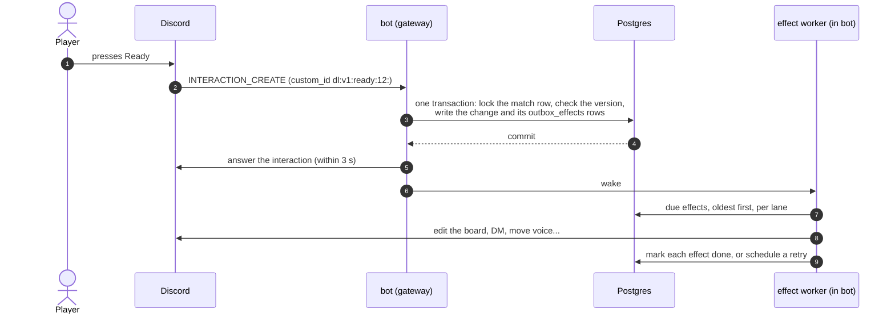

# Architecture

The bot is one Python codebase and one app image (the root `Dockerfile`), run as three services
that each start one command from it, behind a Caddy edge and in front of Postgres. Every
environment, from your laptop to a client's server, runs the same `compose.yaml` with one override
file on top. It is sized for an inhouse of up to 50 people at once with long quiet stretches: a
handful of database connections, one web worker, one bot process.

## Services

| Service | Image | What it does |
|---|---|---|
| `edge` | `caddy` | The only way in. Plain HTTP on 127.0.0.1 locally; with `EDGE_SITE` set to a domain, HTTPS on 80 and 443 with a certificate it gets and renews itself. 21 MB uploads, security headers, gzip and zstd, an optional `/admin/` IP allowlist (`EDGE_ADMIN_CIDRS`), a JSON log line per request (`infra/caddy/Caddyfile`) |
| `web` | app | `uvicorn config.asgi`, one worker: the Django admin, the calibration dashboard, and their static files through WhiteNoise. `/healthz` says it is serving, `/readyz` that Postgres answers |
| `bot` | app | `manage.py runbot`: the Discord gateway connection, clicks and slash commands, the effect worker that makes every Discord change, the deadline loop (timers, and the daily prune), and the health watchdog |
| `migrate` | app | One-shot: `migrate` and `load_presets`, then exits. It runs on every `up`, and web and bot wait for it |
| `db` | `postgres:17` | All league state, in UTC, with page checksums |
| `discord-sim`, `control-panel` | `services/` | Dev and test only: a fake Discord (REST v10, the gateway, a control API) with a deadlock-api stand-in, and a UI over it |
| `tests`, `chrome`, `e2e` | `Dockerfile` (`test`), `tests/e2e` | Test only: the unit suite, a Playwright server, the browser suite |

Every service runs on a read-only root filesystem with no Linux capabilities, `no-new-privileges`,
an init process, memory and process limits, rotated JSON logs and a healthcheck, and the app's as
a non-root user. Images are pinned by version and digest. The app image has a `runtime` target
(the default, what production runs), a `dev` target that adds `devtools/` and `fixtures/`, and a
`test` target for the unit suite.


- **Networks.** `edge` holds the edge and web only, so the edge can reach nothing else. `backend`
  holds Postgres and the app's services; the bot reaches Discord from there. Only the edge
  publishes ports (80 and 443 in production, 127.0.0.1 elsewhere).
- **Database.** One login, `dayshift`, from `POSTGRES_PASSWORD`. The bot keeps one connection
  (all its database work runs on one thread, `league/asyncdb.py`); web opens one per request in
  flight and closes it after. The rating ledger's append-only rule is enforced by triggers
  (`league/db_guards.py`), installed after every `migrate`, whoever logs in.
- **Secrets.** `.env` is the app's environment file. A deployed server's is written by Ansible
  from the client's vault ([../deploy/README.md](../deploy/README.md)).

## A click, from Discord to Discord



1. The `custom_id` carries the action, the match and the step, so the handler needs no memory of
   its own and an old button still works after a restart.
2. The handler validates and calls one function in `league/services`. That function changes the
   match in one transaction. `Match.objects.lock()` takes the row lock, and `version` and
   `step_index` checks and unique keys settle races between two clicks. A match's own rules live
   on the model (`match.record_transition()`, `match.mode`, `match.captain_of()`); the services
   are the transactions that span models.
3. Nothing in the transaction talks to Discord. What should change there is written as
   `outbox_effects` rows in the same transaction, so a change and its effects commit together or
   not at all.
4. The worker runs due effects in order within each lane (one per match, and one per kind and
   server for work outside a match), so one slow or failing match never holds up another.
   Team voice setup, member moves, swaps and voice cleanup use a separate ordered lane per match,
   so a delayed voice channel does not hold up its draft board. Cleanup cancels pending setup
   and moves; a channel returned after the players leave is recorded and cleaned up.
   Team voice channels are pooled per server (`voice_channel_slots`) and reused rather than
   created and deleted for every match ([Team voice pool](match-flow.md#team-voice-pool)).
   Server errors and rate limits are retried with backoff; an effect that keeps failing ends as
   `failed`, visible in the admin and logged as an error.

## Staying inside Discord's limits

Discord allows 50 requests a second overall and limits each channel's requests of each kind on
its own. Replies to button presses don't count towards the 50. 10,000 refused requests (401, 403
and 429, except a shared-scope 429) in ten minutes get the bot's IP banned for a while. The bot
keeps well clear of that:

- **discord.py paces requests.** It reads the rate-limit headers, holds back a request it knows
  would be refused, and waits out a 429. Past a minute (`max_ratelimit_timeout`) it raises
  instead, and the worker retries that effect after the wait rather than stall its lane. The 12
  member moves when teams are set, or at cleanup, are paced the same way; nothing batches them.
- **Fewer calls.** Board, queue and leaderboard renders coalesce, and the queue and a ready
  check's board wait a moment so a burst is one edit. A render that would show the same thing is
  skipped (a fingerprint of the view, per message, forgotten every few hours and on restart).
  Each channel's newest message is known from the gateway's events, so keeping a board in view
  doesn't read history. One invite per channel serves a whole pop. Slash commands are synced
  only when they change (`communities.commands_fingerprint`).
- **Old messages.** Discord caps edits to a message over an hour old (error 30046). The queue
  panel, leaderboard pages and boards post a fresh message and delete the old one; any other
  effect hitting the cap is skipped.
- **Counting.** Every response passes an aiohttp trace (`bot/request_health.py`) that counts the
  refusals Discord counts, logs the ten-minute total, and posts an error past 1,000.
  Once a minute, `Discord API usage` logs request totals by method, normalized route and status,
  network failures, and the last observed bucket limit, remaining requests and reset delay.
  A 429 is logged separately with its scope and retry header; a long wait raised before a new
  HTTP request is logged as `Discord effect deferred by rate limit`. Tokens and query strings
  are excluded. Bucket values are observations from the last response, not a live global quota.
- **Unavailable DMs.** A failed DM delivery is remembered for 60 seconds, so further notices in
  the same burst use the existing channel fallback without another refused DM request. After
  that the bot tries again, allowing changed privacy settings to take effect. Server errors
  and rate limits do not enter this cache.
- **Voice pacing.** Per server, voice-channel creation, member moves, voice deletion and status
  changes are serialized separately from text requests. The bot pauses for 5 seconds after a
  creation and 1 second after other paced voice operations. Configure these using
  `VOICE_CREATE_INTERVAL_SECONDS` and `VOICE_ACTION_INTERVAL_SECONDS`. These are conservative
  application delays, not Discord limits; the API's returned cooldown still takes precedence.
- **Long quota windows.** `bot/ratelimits.py` corrects discord.py 2.7's bucket wait-cap behavior:
  available tokens may be used even if the window resets tomorrow. Exhausted buckets retain
  their expiry and respect the wait cap; HTTP 429 handling remains in discord.py. This small
  per-client bucket compatibility layer uses library internals and has regression tests, so
  check it when upgrading discord.py.
- **Chat and voice events stay off the database thread.** The bot sees every message and voice
  move in the server. An in-memory list of the channels that matter (`bot/watched.py`) drops
  the rest before they queue behind button presses on the one database thread.

## A timer

A timer is a row: `deadline_at` on the match, the sub request or the offer. The bot's deadline
loop fires due ones every second through the same service a click would use, so a timeout and a
click can never disagree. After downtime, every past-due deadline first gets 60 seconds of grace,
so nobody loses a turn to a restart.

## Knowing it's healthy

Just enough to know when something needs a person:

| Signal | Catches | Where it goes |
|---|---|---|
| Container healthchecks (`/readyz`, the bot's heartbeat file, `pg_isready`, the edge) | A process that died or stuck | `docker compose ps`; on a server, `dayshift-health.timer` posts a change to the alert webhook |
| The bot's watchdog (`league/services/health.py`), every minute | Timers that stopped firing; Discord work piling up | The operator's error channel, once when it starts and once when it clears |
| `HEALTHCHECK_PING_URL`, pinged by the watchdog | The whole server or the bot going away | Your dead man's switch (healthchecks.io or similar) |
| The error log (`bot/error_log.py`) | Every ERROR, such as an effect that failed for good | Each server's `/seterrorchannel` channel, and the operator's |
| Backup unit failures | A nightly dump that didn't happen | The alert webhook |

Logs are JSON on stdout, rotated by Docker; `docker compose logs` is enough at this size.

## Environments

| Environment | Compose files | Project | What differs |
|---|---|---|---|
| Quickstart | `compose.yaml` | `dayshift` | HTTP on 127.0.0.1:8000, Postgres on 127.0.0.1:55432 for host tools |
| Dev | `+ compose.dev.yaml` | `dayshift-dev` | The `dev` target, `DEBUG`, the dev control API, the simulator and the control panel (profile `sim`), every port an env var ([dev/README.md](dev/README.md)) |
| Test | `+ compose.test.yaml` | `dayshift-test` | Postgres on tmpfs, nothing published, the `unit` and `e2e` profiles |
| Production | `+ deploy/compose.prod.yaml` | per client | The published image at a pinned tag, HTTPS for the domain, `DEBUG` forced off, Postgres unpublished ([../deploy/README.md](../deploy/README.md)) |

The app refuses to start with a combination that only makes sense on your machine: an empty
`DJANGO_SECRET_KEY` with `DEBUG` off, or `DEV_CONTROL`, `DISCORD_SIM_URL`, `DISCORD_API_BASE` or
`DISCORD_GATEWAY_URL` without `DEBUG`. `manage.py check --deploy` is clean with the production
settings (`tests/test_settings.py`).

## Code layout

```
league/domain/    Pure rules, no Django or Discord: ratings (openskill_v1), strikes and
                  captain eligibility (standing), Steam IDs, mode schema, draft plan, engine
                  (statuses, transitions per kind, the captain coinflip), copy (what players read)
league/models/    The tables (docs/database.md). Player is Django's user model (AUTH_USER_MODEL)
league/services/  Transactions: queue, lobby, draft, results, ratings, corrections, awards,
                  standing, penalties, ocr, steam, api_results, calibration, deadlines,
                  permissions, alerts (the staff channel), runtime (each server's settings),
                  and Bebot's tools: scrims, prio, pings
league/integrations/  The deadlock-api client. Network only, no database
league/web/       The staff calibration dashboard
league/admin/     Django admin
bot/handlers/     Clicks and modals: validate, call a service, acknowledge. permissions.py holds
                  the staff area checks every command and button uses
bot/commands/     Slash commands
bot/renderers/    State to Discord components, with no I/O. style.py is the one look (Bebot's
                  colours, titles and turn strip); board.py renders ranked matches and scrims;
                  names.py names the channels the bot creates
bot/effects/      Runs Discord side effects from the outbox, with retries
bot/error_log.py  Posts ERROR logs to each server's /seterrorchannel channel
config/           Django settings, the ASGI app, health probes (/healthz, /readyz), logging
scoreocr/         Scoreboard screenshot reader, used through league/services/ocr.py when installed
presets/          Draft modes, hero emojis and draft GIFs, loaded by load_presets

devtools/         Dev only: the /_control/ API, the autopilot that plays matches, scenarios
fixtures/dev/     Dev only: the community, season, staff grants and players dev_seed loads
services/discord-sim/    Dev and test only: a fake Discord (REST, gateway) and deadlock-api
services/control-panel/  Dev and test only: the control panel over the two APIs above
tests/            The unit suite (pytest, Postgres)
tests/e2e/        The browser suite: Playwright against the whole stack and the simulator

infra/caddy/      The edge's Caddyfile: HTTPS, headers, uploads, the admin allowlist
compose*.yaml     The stack, and an override per environment (dev, test)
Makefile          Every dev, test and deploy task: `make` lists them
deploy/           Ansible for a client's server, and the production compose overrides
scripts/          dev-vm.ps1: the Multipass dev VM for Windows
docs/             The host and staff guides, architecture and the developer guide
```

### The rules that keep it reliable

- **Handlers are stateless.** A `custom_id` holds the action, match and step, and the rest comes
  from the database. Old buttons survive a restart, and a stale click gets a polite refusal.
- **Races end in the database.** Row locks, `version` and `step_index` checks, and unique keys.
- **Timers are rows.** A poller applies timeouts through the same path as a click. After downtime,
  past-due deadlines get 60 s of grace.
- **Discord calls happen after commit.** State changes write `outbox_effects` in the same
  transaction, and a worker runs them in order per lane, retrying on server errors. Each match (or
  scrim) is a lane, and other work gets one lane per kind and server, so one that keeps failing
  never holds up another.

## Design decisions

- **One codebase, one image.** The web process, the bot and the migrations share the models and
  the rules, and must agree on the schema at every moment. `migrate` runs first from the image the
  services then start from, and a rollback is one tag.
- **One bot process.** Discord changes need the gateway's cache (who is in which voice channel,
  each guild's channels and members), so the effect worker runs beside the gateway. The deadline
  loop and the watchdog run there too: at this size a separate scheduler only adds a container.
- **No pooler.** Three processes use two or three connections. Django's persistent connection in
  the bot and per-request connections in web are enough, with nothing to configure.
- **Caddy at the edge.** Automatic HTTPS with nothing on the host to renew certificates, and a
  Caddyfile short enough to read in one go.
- **Healthchecks over metrics.** No Prometheus or dashboards: the checks above say when to act,
  and an idle week costs nothing.

## Pointing the bot at the simulator

The bot in dev is the real bot, unmodified. `DISCORD_API_BASE` (default
`https://discord.com/api/v10`) and `DISCORD_GATEWAY_URL` (default `wss://gateway.discord.gg/`)
move it; `bot/client.py` applies them before connecting and logs that it isn't talking to Discord.
`DISCORD_SIM_URL` tells the dev control API where the simulator's control API is and, unless
`DEADLOCK_API_BASE` is set, sends deadlock-api calls to the simulator's stand-in. The simulator's
snowflakes start at `1_100_000_000_000_000_000`; the guild is `1_100_000_000_000_000_001`.
