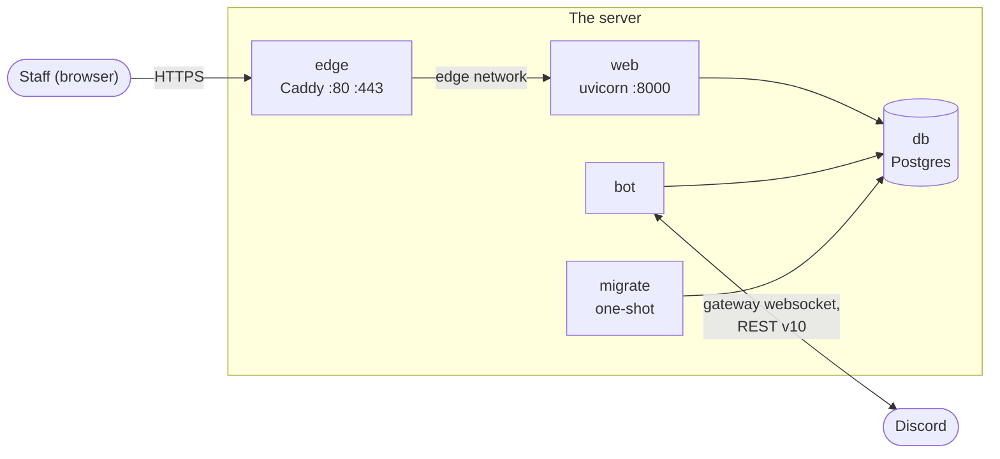
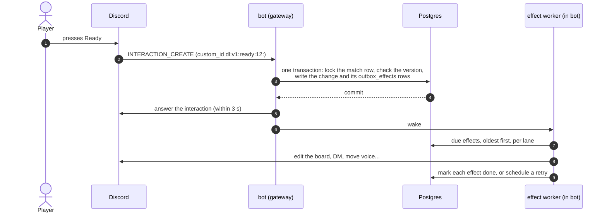

# Architecture

The bot is one Python codebase and one app image (the root `Dockerfile`), run as three services
that each start one command from it, behind a Caddy edge and in front of Postgres. Every
environment, from your laptop to a client's server, runs the same `compose.yaml` with one override
file on top. It is sized for an inhouse of up to 50 people at once with long quiet stretches: a
handful of database connections, one web worker, one bot process.

## Services

| Service | Image | What it does |
|---|---|---|
| `edge` | `caddy` | The only way in. Plain HTTP on 127.0.0.1 locally; with `EDGE_SITE` set to a domain, HTTPS on 80 and 443 with a certificate it gets and renews itself. 21 MB uploads, security headers, gzip and zstd, an optional `/admin/` IP allowlist (`EDGE_ADMIN_CIDRS`), a JSON log line per request (`infra/caddy/Caddyfile`) |
| `web` | app | `uvicorn config.asgi`, one worker: the Django admin, the calibration dashboard, and their static files through WhiteNoise. `/healthz` says it is serving, `/readyz` that Postgres answers |
| `bot` | app | `manage.py runbot`: the Discord gateway connection, clicks and slash commands, the effect worker that makes every Discord change, the deadline loop (timers, and the daily prune), and the health watchdog |
| `migrate` | app | One-shot: `migrate` and `load_presets`, then exits. It runs on every `up`, and web and bot wait for it |
| `db` | `postgres:17` | All league state, in UTC, with page checksums |
| `discord-sim`, `control-panel` | `services/` | Dev and test only: a fake Discord (REST v10, the gateway, a control API) with a deadlock-api stand-in, and a UI over it |
| `tests`, `chrome`, `e2e` | `Dockerfile` (`test`), `tests/e2e` | Test only: the unit suite, a Playwright server, the browser suite |

Every service runs on a read-only root filesystem with no Linux capabilities, `no-new-privileges`,
an init process, memory and process limits, rotated JSON logs and a healthcheck, and the app's as
a non-root user. Images are pinned by version and digest. The app image has a `runtime` target
(the default, what production runs), a `dev` target that adds `devtools/` and `fixtures/`, and a
`test` target for the unit suite.

- **Networks.** `edge` holds the edge and web only, so the edge can reach nothing else. `backend`
  holds Postgres and the app's services; the bot reaches Discord from there. Only the edge
  publishes ports (80 and 443 in production, 127.0.0.1 elsewhere).
- **Database.** One login, `draftbot`, from `POSTGRES_PASSWORD`. The bot keeps one connection
  (all its database work runs on one thread, `league/asyncdb.py`); web opens one per request in
  flight and closes it after. The rating ledger's append-only rule is enforced by triggers
  (`league/db_guards.py`), installed after every `migrate`, whoever logs in.
- **Secrets.** `.env` is the app's environment file. A deployed server's is written by Ansible
  from the client's vault ([../deploy/README.md](../deploy/README.md)).

## A click, from Discord to Discord

1. The `custom_id` carries the action, the match and the step, so the handler needs no memory of
   its own and an old button still works after a restart.
2. The handler validates and calls one function in `league/services`. That function changes the
   match in one transaction. `Match.objects.lock()` takes the row lock, and `version` and
   `step_index` checks and unique keys settle races between two clicks. A match's own rules live
   on the model (`match.record_transition()`, `match.mode`, `match.captain_of()`); the services
   are the transactions that span models.
3. Nothing in the transaction talks to Discord. What should change there is written as
   `outbox_effects` rows in the same transaction, so a change and its effects commit together or
   not at all.
4. The worker runs due effects in order within each lane (one per match, and one per kind and
   server for work outside a match), so one slow or failing match never holds up another.
   Server errors and rate limits are retried with backoff; an effect that keeps failing ends as
   `failed`, visible in the admin and logged as an error.

## A timer

A timer is a row: `deadline_at` on the match, the sub request or the offer. The bot's deadline
loop fires due ones every second through the same service a click would use, so a timeout and a
click can never disagree. After downtime, every past-due deadline first gets 60 seconds of grace,
so nobody loses a turn to a restart.

## Knowing it's healthy

Just enough to know when something needs a person:

| Signal | Catches | Where it goes |
|---|---|---|
| Container healthchecks (`/readyz`, the bot's heartbeat file, `pg_isready`, the edge) | A process that died or stuck | `docker compose ps`; on a server, `draftbot-health.timer` posts a change to the alert webhook |
| The bot's watchdog (`league/services/health.py`), every minute | Timers that stopped firing; Discord work piling up | The operator's error channel, once when it starts and once when it clears |
| `HEALTHCHECK_PING_URL`, pinged by the watchdog | The whole server or the bot going away | Your dead man's switch (healthchecks.io or similar) |
| The error log (`bot/error_log.py`) | Every ERROR, such as an effect that failed for good | Each server's `/seterrorchannel` channel, and the operator's |
| Backup unit failures | A nightly dump that didn't happen | The alert webhook |

Logs are JSON on stdout, rotated by Docker; `docker compose logs` is enough at this size.

## Environments

| Environment | Compose files | Project | What differs |
|---|---|---|---|
| Quickstart | `compose.yaml` | `dl-mm-discord` | HTTP on 127.0.0.1:8000, Postgres on 127.0.0.1:55432 for host tools |
| Dev | `+ compose.dev.yaml` | `draftbot-dev` | The `dev` target, `DEBUG`, the dev control API, the simulator and the control panel (profile `sim`), every port an env var ([dev/README.md](dev/README.md)) |
| Test | `+ compose.test.yaml` | `draftbot-test` | Postgres on tmpfs, nothing published, the `unit` and `e2e` profiles |
| Production | `+ deploy/compose.prod.yaml` | per client | The published image at a pinned tag, HTTPS for the domain, `DEBUG` forced off, Postgres unpublished ([../deploy/README.md](../deploy/README.md)) |

The app refuses to start with a combination that only makes sense on your machine: an empty
`DJANGO_SECRET_KEY` with `DEBUG` off, or `DEV_CONTROL`, `DISCORD_SIM_URL`, `DISCORD_API_BASE` or
`DISCORD_GATEWAY_URL` without `DEBUG`. `manage.py check --deploy` is clean with the production
settings (`tests/test_settings.py`).

## Design decisions

- **One codebase, one image.** The web process, the bot and the migrations share the models and
  the rules, and must agree on the schema at every moment. `migrate` runs first from the image the
  services then start from, and a rollback is one tag.
- **One bot process.** Discord changes need the gateway's cache (who is in which voice channel,
  each guild's channels and members), so the effect worker runs beside the gateway. The deadline
  loop and the watchdog run there too: at this size a separate scheduler only adds a container.
- **No pooler.** Three processes use two or three connections. Django's persistent connection in
  the bot and per-request connections in web are enough, with nothing to configure.
- **Caddy at the edge.** Automatic HTTPS with nothing on the host to renew certificates, and a
  Caddyfile short enough to read in one go.
- **Healthchecks over metrics.** No Prometheus or dashboards: the checks above say when to act,
  and an idle week costs nothing.

## Pointing the bot at the simulator

The bot in dev is the real bot, unmodified. `DISCORD_API_BASE` (default
`https://discord.com/api/v10`) and `DISCORD_GATEWAY_URL` (default `wss://gateway.discord.gg/`)
move it; `bot/client.py` applies them before connecting and logs that it isn't talking to Discord.
`DISCORD_SIM_URL` tells the dev control API where the simulator's control API is and, unless
`DEADLOCK_API_BASE` is set, sends deadlock-api calls to the simulator's stand-in. The simulator's
snowflakes start at `1_100_000_000_000_000_000`; the guild is `1_100_000_000_000_000_001`.
