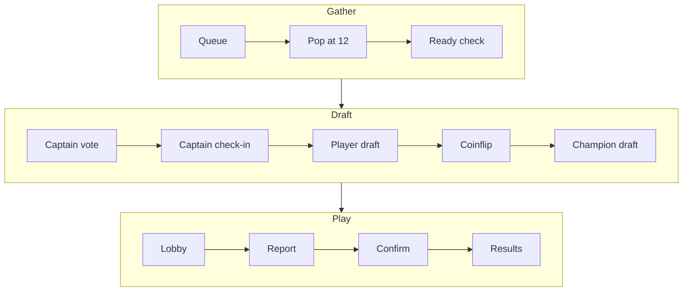

# How a match runs

Every ranked match runs the same flow, from the queue popping to the result. This page has every
step with its timer and fallback, the draft modes, subs, and how the match channel behaves. The
player-facing version is the wiki's
[Playing a Match](https://github.com/VARSITYLUNCHBUG/DayShift/wiki/Playing-a-Match).

## The steps

| Step | What happens | Clock and fallback |
|---|---|---|
| Queue | Join and Leave buttons, FIFO. Voice isn't required | Blocked by a cooldown or a live match |
| Pop at 12 | Creates a private text channel, `match-12`. The Waiting Room is the lobby's voice channel | Queue waits at `max_concurrent_matches` |
| Gather | In the Waiting Room: nothing to do. Anywhere else: DM with a Waiting Room invite and Ready button. DMs closed: mention in the match channel | |
| Ready | Ready button on the board and in the "Ready Up" DM. The board is posted right after the lobby ping, before the invites go out, and shows who has readied. The ping is never edited (an edit notifies nobody); it goes when the check moves on, or once nobody is left to call | 180 s. A miss frees the spot, offered down the priority list (the queue, longest wait first). Unfilled in 2 min: cancel, and everyone left goes back to the front of the queue |
| Captain vote | Everyone votes for up to two captains, themselves included, from players with 5 completed matches. Most votes wins; rating breaks ties and fills any gap. Two or fewer eligible, or the Auto Captain setting on: no vote, captains are appointed by experience and rating | 45 s, or closes early once everyone has voted |
| Captain check-in | Each captain presses **I'm here** before anyone is drafted | 60 s (`captains.checkin_seconds`). A captain who misses it is replaced by the next eligible player in vote order, who gets the full time. With nobody eligible left, the draft starts with the captains it has |
| Player draft | `FSSFFSSFFS`, lower-rated captain first. Last player is assigned. No message announces it: the board shows the captains and whose pick it is | 45 s, then highest rated |
| Team voice | Creates `Match 12 · Kestrel's Team` and the other team's channel, and moves anyone in the Waiting Room. Everyone else gets one channel ping naming them all, with no per-player DM or invite. Players arriving in the Waiting Room later are routed to their team as usual | Never blocks the draft |
| Captain coinflip | The winner chooses a side: 🔶 Hidden King or 🔷 Archmother. The Hidden King is always Pick 1 (team 1) and bans and picks first. (Scrims keep Bebot's two-captain coinflip.) | 20 s, then a random side |
| Player swap | From the coinflip until the game starts, a captain can press **Swap players** to offer one of their players for one of the other team's. Captains stay put. The other captain accepts and the two change teams and voice channels, or declines | 60 s to answer, then it lapses. One offer at a time |
| Champion draft | The mode's ban and pick order, from the team the coinflip put first. 🎲 Random takes a champion on purpose | 40 s a turn. A timeout takes a random champion, for bans too |
| Draft summary | Named like "Crimson Wolf", with a GIF from `presets/draft_gifs.json` and GLHF, above the lobby code prompt | |
| Lobby | deadlock-api's bot always creates the custom lobby; its code is posted and a captain presses Start match. Only if that fails is a random captain asked to create one and enter its code, with the settings checklist ([Lobbies](integrations.md#lobbies)) | No lobby in 3 min counts as a failure. Then 3 min for the host, then the other captain, then cancel |
| Report | Press the team that won, then enter the Deadlock match ID (required, and recorded on the match), and optionally the screenshot, MVP and key players. The report ends the game for its players: the team voices empty into the Waiting Room and everyone can queue again, however the result is then settled. With [score OCR](integrations.md#score-ocr) on, a screenshot is read | 3 h without a report goes to staff |
| Confirm | The other captain confirms, disputes or adds their own report, from the match channel, which stays open until the result is settled | 5 min. Silence confirms |
| Results | The first screenshot, the rating table, 🏅 MVP and ⭐ key players, and scoreboard stats go to the results channel. Once deadlock-api has the match, its scoreboard is posted as a reply ([Result checks](integrations.md#result-checks)). Every screenshot goes to the archive | Effects retry |

Match channels are private to their players and staff to talk in. Anyone with the PUG role (set
with `/setup pug_role`; everyone, without one) can read the text channel and see the team voices,
but not join them unless Open match voice is on.

This is the flow the server used with Bebot and NeatQueue, and it is the only one: every match
runs it. The timers and the ban and pick order live in the draft mode. These values are starting
judgements, not published standards.

## Draft modes

| Mode | Champion draft |
|---|---|
| `draft_3ban` (default) | `B1 B2 B1 B2 P1 P2 P2 P1 P2 P1 B2 B1 P2 P1 P1 P2 P1 P2`: 18 steps, 3 bans a team, 40 s a turn. 1 is the Pick 1 team |
| `bebot_2ban` | Bebot's 16-step, 2-ban order, 40 s a turn |

Switch on the server's page in the admin (**Active mode**). To edit a mode or add your own, see
[Adding a draft mode](admin.md#a-draft-mode).

## Subs

Any player can press **Request a sub** on the board from the ready check until a result is
reported. There are two separate flows:

| Flow | What happens | Clock and fallback |
|---|---|---|
| Sub out, yourself | Opens the slot straight away | The match pauses until the slot is filled |
| Sub out, a teammate | A captain asks for one of their own players or an undrafted one. Not another captain | The other captain approves within 60 s, or the player stays |
| Sub in, named | The leaving player or their captain picks someone, who gets a DM to accept | 45 s to name someone, 60 s for them to accept |
| Sub in, offered | If nobody is named, or the named person says no, the spot is offered by DM down the priority list: whoever in the queue has waited longest | 60 s each, and it's retried as people join |

While any request is pending, the timer is parked and the board hides the phase's buttons (except
the result buttons once the game is on). The sub takes the leaving player's team, captaincy,
lobby-host role and result. The timer resumes where it stopped, with at least 15 s. Nobody in
3 minutes means the match is cancelled with no rating change, and everyone except the leaving
player goes back into the queue. Once captains are set and before the game, it restarts instead
(see [Filling an opening](#filling-an-opening)). At most 4 requests can be pending at once.

Subbing yourself out after the ready check is a dodge, and once the game is on it's a leaver;
cancelling the request costs nothing. See [Captains and strikes](captains-and-strikes.md). All of
these timers live in the draft mode's `subs` section.

## Filling an opening

The queue is the way into matches, and the [priority list](scrims-and-tools.md#priority-list) is
the queue in order of wait. An opening (a missed ready check, a sub out nobody named, or a
restart) is offered down the priority list: whoever in the queue has waited longest, isn't in a
match and hasn't stepped out. Being in the Waiting Room doesn't count: it's a public channel, and
not everyone there wants to play. Each offer is a DM, and only a DM, with **I'll sub in** and
**Can't right now**, for 60 s, then the next person. Someone whose DMs are closed is skipped. Each
person is offered one spot at a time.

A missed ready check keeps the lobby: the players who missed it are taken out (with their usual
missed-ready cooldown), their spots are offered for 2 minutes (`ready_check.refill_seconds`), and
once they're filled the captain vote starts. If they aren't, the lobby is cancelled and everyone
still in it goes back to the front of the queue.

A sub out nobody fills after captains are set, but before the game starts, restarts the lobby
rather than cancelling it. The match is voided (its draft history is kept exactly as it was) and a
successor match takes over its channels and everyone who stayed. The empty seats are offered the
same way, and once they're filled a fresh captain vote starts. Unfilled, it's cancelled as above.
Before captains are set, an unfilled sub out still cancels; once the game is on, the
[early-leave rules](captains-and-strikes.md#early-leaves) apply.

## The match channel

Players can chat freely, and the board stays at the bottom:

- **Pings** sit just above the board. A status change deletes the earlier ones, and so does a new
  lobby host or a repeat staff request. Chat is never deleted.
- **A state change** edits the board if it's the last message. Otherwise a new board is posted at
  the bottom and the old one deleted.
- **Chat** moves the board once three messages sit below it and chat has been quiet for 5 s, or
  20 s after the third message if chat doesn't stop. A board that moves mid-click could cost a
  captain a wrong ban, so it doesn't move on every message. Change this with the `BOARD_MOVE_*`
  values in `league/services/effects.py`.
- **The champion draft is Bebot's board**: 🏆 Draft #N with its name, 👑 Captains with the timer
  on the captain whose turn it is, 🚫 Bans, each side's heroes one per line ("(random choice)" for
  🎲, "(randomed)" for a timeout), and the bracketed turn strip, in the acting side's colour. Under
  it, each team's rating and chance to win, and "Ban 3 of 4. Next: Pike picks." The finished draft
  ends in `# GLHF` with a GIF.
- **Choices are buttons**, so everything is visible at once. Champions are red to ban and green to
  pick. Drafted players and taken champions stay in place, greyed out, so nothing shifts under a
  click. The champion grid has messages of its own directly below the board, split evenly over two
  because Discord allows 40 components per message, with Random at the end. They are posted afresh
  each turn rather than edited, so no "(edited)" tag splits the grid. A roster above 55 falls back
  to dropdowns.

The bot only learns that a message was sent. It doesn't have the Message Content intent, so it
can't read chat.
